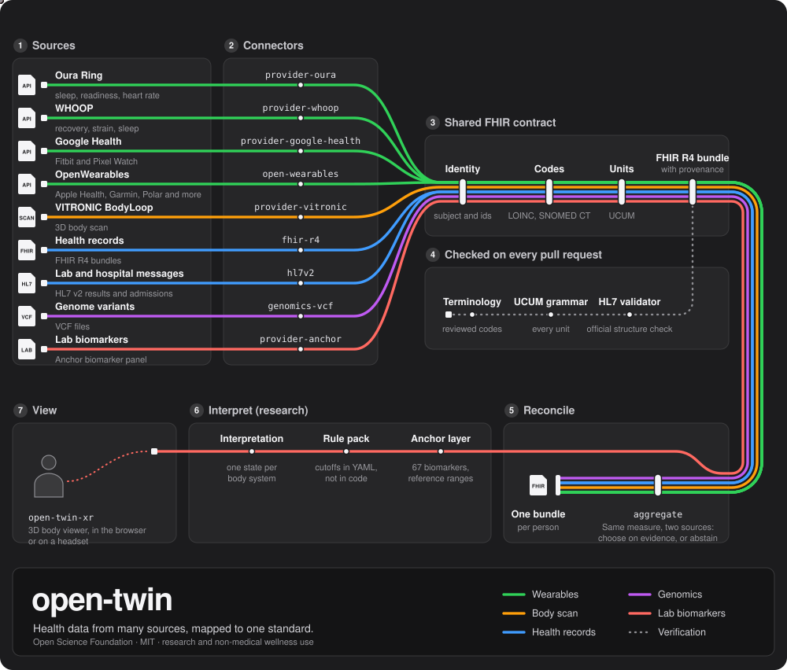

# open-twin

TypeScript libraries for converting vendor health data, HL7 v2 messages and VCF
files into **HL7 FHIR R4 bundles**, validating incoming FHIR, and reconciling
matching measurements across sources.

Developed under the Open Science Foundation for **research and non-medical
consumer wellness**. Experimental interpretation modules support research
hypothesis generation. **Medical use is outside the intended scope**; see
[intended use](docs/INTENDED-USE.md).



## How it works

A ring, a body scanner, a hospital lab system and a genome file each describe
health data in their own way, with their own codes and units. open-twin
translates all of them into one standard, FHIR R4, so measurements from
different sources can sit side by side for the same person.

The map reads left to right, then back along the bottom row.

1. **Sources.** Where the data starts: wearables, a 3D body scanner, health
   records, lab results and genome variant files.
2. **Connectors.** One package per source. Each reads or fetches its data and
   maps it to FHIR.
3. **Shared FHIR contract.** What every connector must agree on is decided once,
   in `fhir-core`: whose data it is, which standard codes describe it, and which
   units it carries.
4. **Checks.** Every pull request checks units against UCUM, codes against
   recorded human review, and example bundles against the official HL7 validator.
5. **Reconcile.** When two sources report the same measure on the same day,
   `aggregate` chooses one on published validation evidence, or records that it
   cannot. Every source value is kept.
6. **Interpret.** A research module compares lab biomarkers with Anchor-layer
   reference ranges using a rule pack, and reports one state per body system.
7. **View.** [open-twin-xr](https://github.com/Opening-Science/open-twin-xr), a
   separate repository, shows those states on a 3D body in the browser or on a
   headset.

Two rules run through all of it. Missing data stays missing; it is never
filled with zero. And where the evidence does not support an answer, the
library says so instead of guessing.

## Get started

Use Node 22 (as in CI; `engines` declares >=20) and pnpm 11.17.0.

```bash
npm install -g pnpm@11.17.0
pnpm install --frozen-lockfile
pnpm build
pnpm lint
pnpm typecheck
pnpm test
pnpm verify
pnpm emit-bundles out/
```

Build first: workspace packages resolve each other's compiled exports.
CI also runs the official HL7 validator; a local validator run requires Java 21. See [Onboarding](ONBOARDING.md).

## Packages

Automated npm publishing is disabled; use the source checkout.

Ten connector and core library packages (names use the `@open-twin/` scope):

| package | direction | source |
|---|---|---|
| [`fhir-core`](packages/fhir-core) | — | the shared contract: systems, units, identity, provenance, errors |
| [`aggregate`](packages/aggregate) | — | cross-source reconciliation |
| [`provider-oura`](packages/provider-oura) | vendor → FHIR | Oura Ring v2 API |
| [`provider-whoop`](packages/provider-whoop) | vendor → FHIR | WHOOP Developer API v2 |
| [`provider-google-health`](packages/provider-google-health) | vendor → FHIR | Google Health API v4 |
| [`provider-vitronic`](packages/provider-vitronic) | vendor → FHIR | VITRONIC BodyLoop body scanner |
| [`open-wearables`](packages/provider-open-wearables) | vendor → FHIR | OpenWearables normalised schema |
| [`fhir-r4`](packages/fhir-r4) | FHIR → FHIR | foreign R4 bundles: validation + normalisation |
| [`hl7v2`](packages/hl7v2) | HL7 v2 → FHIR | ORU/ADT messages |
| [`genomics-vcf`](packages/genomics-vcf) | VCF → FHIR | variant calls, Genomics Reporting IG |

Four more workspace packages are research modules:

| package | role |
|---|---|
| [`anchor-layer`](packages/anchor-layer) | versioned Anchor biomarker catalogue and reference ranges |
| [`provider-anchor`](packages/provider-anchor) | lab biomarker measurements → FHIR R4 Observations |
| [`interpreter`](packages/interpreter) | evaluates a YAML rule pack over biomarker observations |
| [`interpretation-contract`](packages/interpretation-contract) | schema and validator for the document open-twin-xr reads |

Package READMEs document their APIs and supported inputs.

The Google Health connector uses `health.googleapis.com/v4`; it is not an
Android Health Connect integration.

## Scope and verification

This is an experimental library collection. Applications supply scheduling,
storage, authentication, access controls and user interfaces.

Verification combines unit tests, UCUM and terminology checks, and example-bundle validation. Some terminology reviews and semantic canaries remain advisory or record known gaps; see the [verification baseline](docs/findings/verify-baseline.md). Passing CI does not establish clinical accuracy, regulatory conformity or correctness for every input.

Tests once passed on output that carried radians labelled as degrees; see
[BUILD-SUMMARY.md](BUILD-SUMMARY.md) for the defect history.

Before handling participant data or exposing outputs to consumers, read
[Intended use and integration responsibilities](docs/INTENDED-USE.md) and,
for US audiences, the [US supplement](docs/US-USE.md).

## Documentation

| Read | For |
|---|---|
| [ONBOARDING.md](ONBOARDING.md) | Setup, verification and first contribution |
| [DECISIONS.md](DECISIONS.md) | Shared identity, terminology, units and interpretation rules |
| [docs/00-MAP.md](docs/00-MAP.md) | Detailed documentation map |
| [Contributing.md](Contributing.md) | Contribution and review workflow |
| [CLAUDE.md](CLAUDE.md) | Coding-agent instructions |
| [BUILD-SUMMARY.md](BUILD-SUMMARY.md) | Dated architecture and review record |
| [PROVENANCE.md](PROVENANCE.md) | Repository history |
| [docs/synthea.md](docs/synthea.md) | Synthetic FHIR cohort generation |

Development and pull requests for this repository are hosted at
[Opening-Science/open-twin](https://github.com/Opening-Science/open-twin).

## People

| Name | Work |
|---|---|
| Peter Dike ([@CPD9](https://github.com/CPD9)) | Interpretation layer, Anchor biomarker ingest, the WHOOP connector, the Synthea cohort |
| Martin Etzrodt ([@etzm](https://github.com/etzm), [ORCID](https://orcid.org/0000-0003-1928-3904)) | Conceived open-twin as an open connector repository, in analogy to Bioconductor; shared FHIR core, verification gates, reconciliation, the FHIR R4, HL7 v2, VCF and OpenWearables packages, intended-use guidance |
| Paul Matthias ([@PaulMatthiasVUSE](https://github.com/PaulMatthiasVUSE)) | Started the repository; maintenance, dependencies, security policy and review |
| Robin Wilkening ([ORCID](https://orcid.org/0000-0002-8332-5016)) | Project lead; scientific direction and the original Anchor biomarker list |
| Berk Yildizgorer ([@BerkYildizgorer](https://github.com/BerkYildizgorer)) | The first Oura, Google Health and VITRONIC connectors, with their mappers, tests and CI |

## Licence and independence

[MIT](LICENSE) covers project code and documentation to the extent the copyright
holders can grant those rights. Third-party terminology, datasets and vendor services
may have separate terms; see [third-party rights](docs/INTENDED-USE.md#third-party-rights).
Vendor names identify independent integrations and do not imply endorsement.
